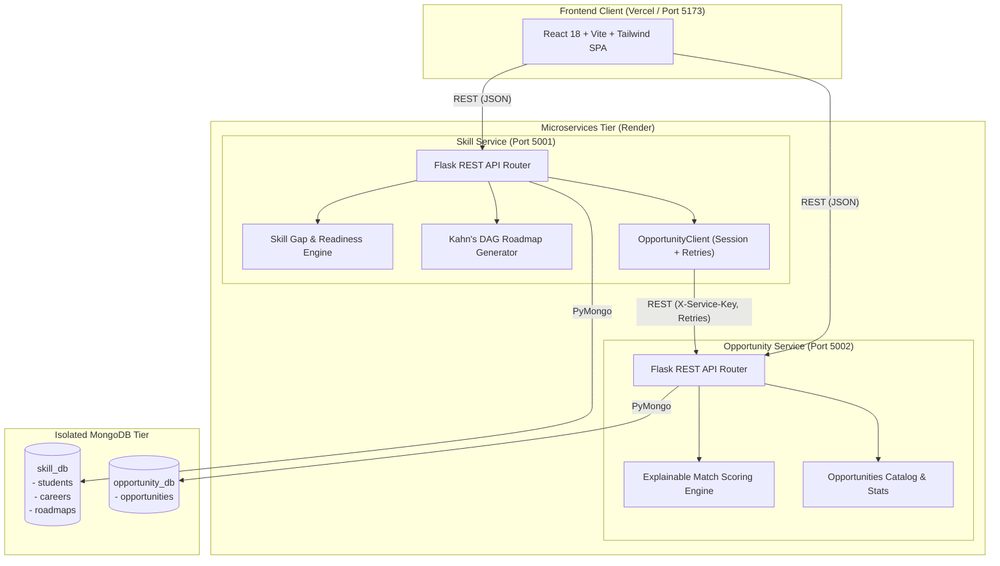

# SkillBridge 🎓

**A Distributed Microservices Platform for Student Skill Gap Analysis, Topological Roadmaps, and Opportunity Discovery**

[](https://github.com/your-username/skillbridge/actions)
[](https://www.python.org/downloads/)
[](https://react.dev/)
[](https://tailwindcss.com/)
[](https://www.mongodb.com/)
[](LICENSE)

---

## 🌟 Overview

**SkillBridge** solves a fundamental challenge faced by computer science and engineering students: the gap between academic university curricula and current industry expectations. 

Instead of a fragile monolithic application, SkillBridge is architected as two decoupled Python microservices with an isolated **Database-per-Service** design, connected to a premium Linear/Vercel-inspired React dashboard. It enables students to assess their career readiness, generate prerequisite-aware learning roadmaps using Kahn's topological sort, and discover ranked experiential opportunities (internships, hackathons, projects) that actively teach their missing skills.

---

## 🚀 Key Features

- **Decoupled Microservices**: Autonomous backend services (`skill-service` on port 5001 and `opportunity-service` on port 5002) with zero database-level sharing.
- **Rule-Based Skill Gap Analysis**: Explainable readiness scoring (0–100%) categorizing student skills into *Matched*, *Developing*, and *Missing*.
- **Topological Learning Roadmaps**: Sequences curriculum stages using Kahn's DAG algorithm, ensuring foundational prerequisites (e.g. *Linux Basics*) are completed before advanced tools (*Docker*, *Kubernetes*).
- **Explainable Opportunity Matching**: Ranks open internships, hackathons, and research projects based on skill compatibility and awards growth bonuses for opportunities that close academic gaps.
- **Graceful Degradation & Resilience**: Outages in downstream opportunity services do not block student access; local roadmaps and gap scores remain fully functional.
- **Render Cold-Start Handling**: Client interceptors detect sleeping free-tier containers (>2.5s) and display an animated banner with a live second counter while the backend retry strategy wakes the service.
- **SaaS-Grade UI**: React 18, Tailwind CSS, Recharts radar charts, Kanban roadmap boards, `Ctrl + K` global command palette, and zero-flicker Light/Dark modes.
- **Self-Documenting APIs**: Live Swagger UI explorer running at `/apidocs/` on both microservices.

---

## 🏛️ System Architecture



---

## 📂 Repository Structure

```
skillbridge/
├── .github/workflows/ci.yml         # GitHub Actions automated test & build pipeline
├── docker-compose.yml               # Local multi-container orchestration
├── render.yaml                      # Render Infrastructure-as-Code Blueprint
├── scripts/
│   └── smoke_test.py                # Post-deployment automated smoke verification
├── docs/
│   ├── architecture.md              # System architecture, data flows, ER diagram
│   ├── algorithms.md                # Mathematical formulas & worked numeric examples
│   ├── API.md                       # Complete API endpoint specifications
│   ├── DEPLOYMENT.md                # Cloud deployment step-by-step instructions
│   ├── PROJECT_REPORT.md            # Comprehensive academic project report
│   ├── DEMO_SCRIPT.md               # 5-7 minute viva demonstration walkthrough
│   ├── VIVA_QA.md                   # 25 viva questions & model answers
│   ├── EVALUATION_CHECKLIST.md      # Phase 1-5 marks-mapping matrix
│   └── screenshots/                 # High-resolution SVG mockups (Light & Dark)
├── postman/
│   ├── SkillBridge.postman_collection.json            # 10 folders, test scripts & workflow
│   ├── SkillBridge_Local.postman_environment.json     # Local environment variables
│   └── SkillBridge_Production.postman_environment.json# Production Render environment
├── skill-service/                   # Port 5001 · Owns students, careers, roadmaps
│   ├── app/                         # App factory, routes, models, services, db
│   ├── clients/                     # Inter-service HTTP client with retry & wake-up
│   ├── scripts/seed.py              # Seeds careers, students, and resources
│   ├── tests/                       # 44 unit & integration tests (86% coverage)
│   ├── Dockerfile, Procfile, runtime.txt, requirements.txt
├── opportunity-service/             # Port 5002 · Owns opportunities catalog & matching
│   ├── app/                         # App factory, routes, models, services, db
│   ├── scripts/seed.py              # Seeds 32+ opportunities
│   ├── tests/                       # 14 unit & integration tests (90% coverage)
│   ├── Dockerfile, Procfile, runtime.txt, requirements.txt
└── frontend/                        # Port 5173 · React 18 + Vite + Tailwind CSS
    ├── src/
    │   ├── api/client.js            # Axios client with cold-start detection
    │   ├── components/              # UI primitives, layout, navbar, command palette
    │   ├── context/                 # Theme, Student, and Toast contexts
    │   └── pages/                   # All 9 core views
    ├── Dockerfile, nginx.conf, vercel.json, package.json
```

---

## ⚡ Quick Start (Local Setup)

### Option 1: Docker Compose (Recommended)
Launch the entire system (MongoDB, Opportunity Service, Skill Service, and Frontend Nginx) with a single command:
```bash
docker-compose up --build
```
- Frontend: [http://localhost:5173](http://localhost:5173)
- Skill Service Swagger UI: [http://localhost:5001/apidocs/](http://localhost:5001/apidocs/)
- Opportunity Service Swagger UI: [http://localhost:5002/apidocs/](http://localhost:5002/apidocs/)

---

### Option 2: Manual Local Setup

#### Prerequisites
- Python 3.11+
- Node.js 18+ & npm
- Local MongoDB running on `mongodb://localhost:27017` (or MongoDB Atlas account)

#### 1. Start Opportunity Service (Port 5002)
```bash
cd opportunity-service
python -m venv venv
venv\Scripts\activate      # On Linux/macOS: source venv/bin/activate
pip install -r requirements.txt
cp .env.example .env
python scripts/seed.py     # Seeds opportunities into opportunity_db
python run.py              # Starts on http://localhost:5002
```

#### 2. Start Skill Service (Port 5001)
```bash
cd ../skill-service
python -m venv venv
venv\Scripts\activate      # On Linux/macOS: source venv/bin/activate
pip install -r requirements.txt
cp .env.example .env
python scripts/seed.py     # Seeds careers, students, and resources
python run.py              # Starts on http://localhost:5001
```

#### 3. Start Frontend Dashboard (Port 5173)
```bash
cd ../frontend
npm install
npm run dev                # Starts on http://localhost:5173
```

---

## 🧪 Running Tests & Quality Verification

```bash
# Run Skill Service tests with code coverage (44 tests, 86% coverage)
pytest --cov=skill-service/app --cov=skill-service/clients skill-service/tests/ -v

# Run Opportunity Service tests with code coverage (14 tests, 90% coverage)
pytest --cov=opportunity-service/app opportunity-service/tests/ -v

# Build and validate frontend production bundle
cd frontend && npm run build

# Run automated post-deployment smoke test suite
python scripts/smoke_test.py
```

---

## 🌐 Live Production Deployments

> [!NOTE]
> The URLs below are placeholders ready to be updated with live production addresses once deployed to Render and Vercel. See [`docs/DEPLOYMENT.md`](docs/DEPLOYMENT.md) for the exact step-by-step instructions.

| Component | Platform | Live URL | Status |
|---|---|---|---|
| **Frontend Dashboard** | Vercel | `[To be updated after Vercel deployment: https://skillbridge.vercel.app]` | ⏳ Awaiting Deploy |
| **Skill Service API** | Render | `[To be updated after Render deployment: https://skillbridge-skill-service.onrender.com]` | ⏳ Awaiting Deploy |
| **Opportunity Service API** | Render | `[To be updated after Render deployment: https://skillbridge-opportunity-service.onrender.com]` | ⏳ Awaiting Deploy |
| **System Status Endpoint** | Render | `[To be updated after Render deployment: https://skillbridge-skill-service.onrender.com/api/system/status]` | ⏳ Awaiting Deploy |
| **API Documentation** | Flasgger UI | `http://localhost:5001/apidocs/` · `http://localhost:5002/apidocs/` | ✅ Live |

---

## 📸 Interface Previews

All previews are stored in high-resolution vector format in [`docs/screenshots/`](docs/screenshots/):

| View | Light Theme | Dark Theme |
|---|---|---|
| **Executive Dashboard** | [`dashboard_light.svg`](docs/screenshots/dashboard_light.svg) | [`dashboard_dark.svg`](docs/screenshots/dashboard_dark.svg) |
| **Skill Inventory** | [`skills_light.svg`](docs/screenshots/skills_light.svg) | [`skills_dark.svg`](docs/screenshots/skills_dark.svg) |
| **Gap Visualizer** | [`gap_analysis_light.svg`](docs/screenshots/gap_analysis_light.svg) | [`gap_analysis_dark.svg`](docs/screenshots/gap_analysis_dark.svg) |
| **Topological Roadmap** | [`roadmap_light.svg`](docs/screenshots/roadmap_light.svg) | [`roadmap_dark.svg`](docs/screenshots/roadmap_dark.svg) |
| **Opportunity Explorer**| [`opportunities_light.svg`](docs/screenshots/opportunities_light.svg) | [`opportunities_dark.svg`](docs/screenshots/opportunities_dark.svg) |
| **System Topology** | [`system_status_light.svg`](docs/screenshots/system_status_light.svg) | [`system_status_dark.svg`](docs/screenshots/system_status_dark.svg) |

---

## 🎓 Evaluation & Documentation Links

- 📑 [Comprehensive Project Report](docs/PROJECT_REPORT.md)
- 🏗️ [System Architecture & ER Diagram](docs/architecture.md)
- 🧮 [Algorithms & Worked Numeric Examples](docs/algorithms.md)
- 📖 [REST API Reference Specification](docs/API.md)
- 🚀 [Production Cloud Deployment Guide](docs/DEPLOYMENT.md)
- 🎬 [5-7 Minute Viva Demonstration Script](docs/DEMO_SCRIPT.md)
- 💡 [25 Viva Technical Questions & Answers](docs/VIVA_QA.md)
- 🎯 [Master Evaluation Criteria Checklist](docs/EVALUATION_CHECKLIST.md)

---

## 👥 Authors & Project Information

- **Project**: SkillBridge: A Microservices-Based Platform for Student Skill Gap Analysis and Opportunity Discovery
- **Course**: Final Year Engineering Project / Distributed Systems Laboratory
- **Team**: `[Student Name(s) & Roll Number(s) Placeholder]`
- **Advisor**: `[Faculty Advisor / Guide Name Placeholder]`
- **Institution**: `[Department of Computer Science & Engineering Placeholder]`
