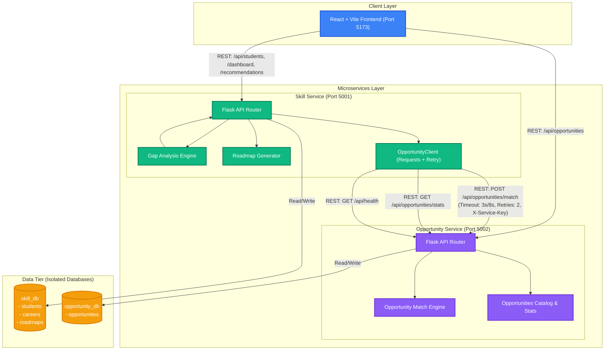
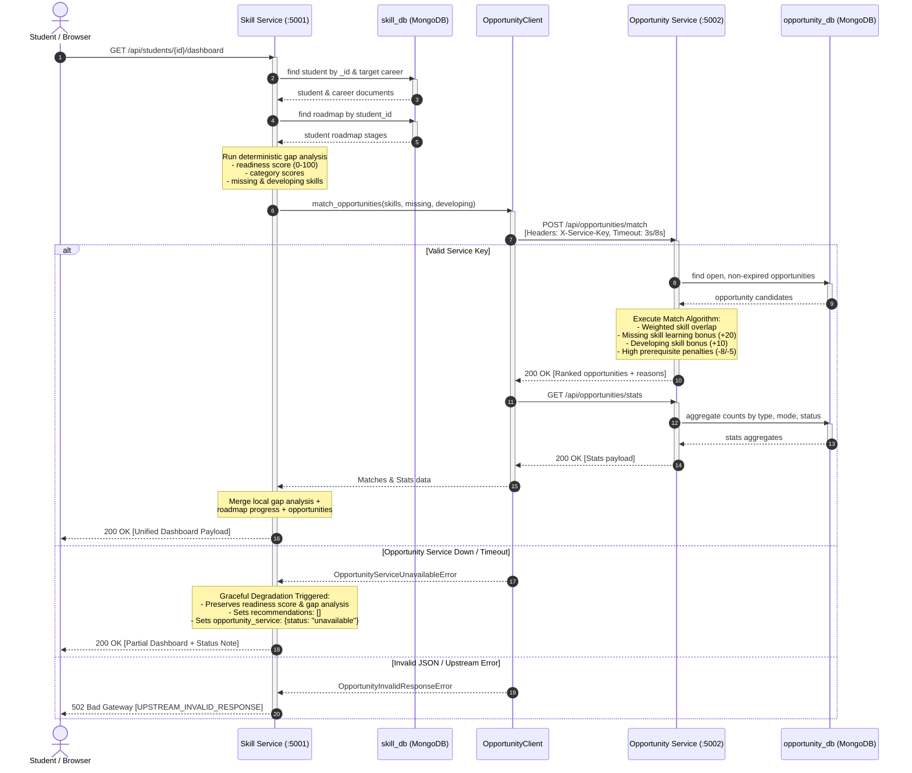

# SkillBridge Microservices Architecture Documentation

## 1. System Overview
**SkillBridge** is a distributed, microservices-based platform engineered to bridge the divide between student academic skill sets and current industry requirements. It provides:
1. Student skill profiling and career path tracking.
2. Rule-based, deterministic skill gap analysis with radar-chart readiness scoring.
3. Automated prerequisite-aware learning roadmap generation.
4. Comprehensive discovery and filtering of experiential opportunities (internships, hackathons, projects, workshops).
5. Inter-service REST orchestration with graceful degradation and robust error handling.

---

## 2. Component Architecture Diagram

The system follows a strict microservices pattern where each domain owns its database.

---

## 3. Sequence Diagram: Inter-Service Recommendation & Dashboard Flow

---

## 4. Database Ownership & Isolation
In accordance with microservice design principles:
- **Zero Database Sharing**: `skill-service` exclusively owns and accesses `skill_db`. `opportunity-service` exclusively owns and accesses `opportunity_db`.
- **Decoupled Lifecycles**: Schemas, indexes, and migrations evolve independently without impacting neighboring services.
- **Cross-Service Communication**: All communication between services traverses authenticated HTTP REST interfaces via `OpportunityClient`.

---

## 5. Inter-Service Communication Specification

### Connection & Resilience Policy
- **HTTP Session**: Persistent `requests.Session()` with connection pooling.
- **Timeouts**: Split timeout — `3.0s` connect timeout, `8.0s` read timeout.
- **Retries with Exponential Backoff**: Max 2 retries with backoff factor `0.3s` automatically retrying on connection errors and HTTP `500`, `502`, `503`, `504` errors using `urllib3.util.Retry`.
- **Authentication**: Optional shared secret via `X-Service-Key` header (configured via `INTER_SERVICE_KEY` environment variable).
- **Outbound Telemetry**: Every outbound request logs HTTP method, target URL, response status code, and millisecond elapsed duration.

---

## 6. Failure Modes & Error Handling Matrix

| Failure Scenario | Upstream Symptom | Handling Strategy | HTTP Code to Client | Payload Behavior |
| :--- | :--- | :--- | :--- | :--- |
| **Opportunity Service Down** | `ConnectionRefused` / `ConnectTimeout` | **Graceful Degradation** | `200 OK` | Returns local skill gap and roadmap intact; sets `recommendations: []`, `opportunity_service: {status: "unavailable"}`. |
| **Opportunity Service Timeout** | `ReadTimeout` (>8s) after retries | **Graceful Degradation** | `200 OK` | Same as above; user workflow is not blocked by slow external service. |
| **Malformed Upstream Response** | Non-JSON body or unexpected payload | **Fail Fast** | `502 Bad Gateway` | Returns `{"success": false, "error": {"code": "UPSTREAM_INVALID_RESPONSE"}}`. Never leaks stack traces. |
| **Invalid Service Key** | HTTP `401 Unauthorized` | **Security Failure** | `502 Bad Gateway` | Returns `{"success": false, "error": {"code": "UPSTREAM_UNAUTHORIZED"}}`. |
| **Strict Upstream Dependence** | Endpoint requiring Opportunity Service | **Service Unavailable** | `503 Service Unavailable` | Returns clear failure notice without leaking internals. |
| **Skill Service DB Outage** | MongoDB connection failure | **Database Down** | `503 Service Unavailable` | Handled by global error handler. |

---

## 7. Collection Schemas & Indexing Strategy

### `skill_db` (Skill Service)
1. **`students`**:
   - `_id`: ObjectId
   - `name`: string
   - `email`: string (Unique index)
   - `college`: string
   - `department`: string
   - `year`: integer (1–4)
   - `career_goal`: string (Career ObjectId)
   - `skills`: array of `{ name: string, level: 1..5, updated_at: ISODate }`
   - `created_at`: ISODate, `updated_at`: ISODate
   - *Indexes*: Unique on `email`, Text search on `name`, `college`, `department`, Ascending on `career_goal`, Ascending on `year`.

2. **`careers`**:
   - `_id`: ObjectId
   - `title`: string
   - `slug`: string (Unique index)
   - `description`: string
   - `category`: string
   - `required_skills`: array of `{ name, required_level (1..5), importance (1..5), prerequisites: [string], category: string }`
   - `created_at`: ISODate, `updated_at`: ISODate
   - *Indexes*: Unique on `slug`, Text search on `title`, `description`, Ascending on `category`.

3. **`roadmaps`**:
   - `_id`: ObjectId
   - `student_id`: string (Student ObjectId)
   - `career_id`: string (Career ObjectId)
   - `stages`: array of ordered stages with learning resources and status (`not_started`, `in_progress`, `completed`).
   - `total_estimated_weeks`: integer
   - `generated_at`: ISODate
   - *Indexes*: Compound index on `(student_id, career_id)`, Ascending on `student_id`.

### `opportunity_db` (Opportunity Service)
1. **`opportunities`**:
   - `_id`: ObjectId
   - `title`: string
   - `type`: `project` | `hackathon` | `internship` | `workshop`
   - `organization`: string
   - `description`: string
   - `required_skills`: array of `{ name: string, min_level: 1..5 }`
   - `difficulty`: `beginner` | `intermediate` | `advanced`
   - `mode`: `online` | `offline` | `hybrid`
   - `location`: string (optional)
   - `start_date`, `deadline`: ISODate strings (optional)
   - `duration`, `stipend`, `prize`: string (optional)
   - `apply_url`: string
   - `tags`: array of string
   - `status`: `open` | `closed`
   - *Indexes*: Text search on `title`, `description`, `organization`, Ascending indexes on `type`, `difficulty`, `mode`, `status`, `deadline`, `tags`, and `required_skills.name`.
